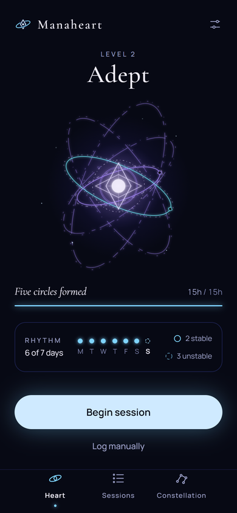
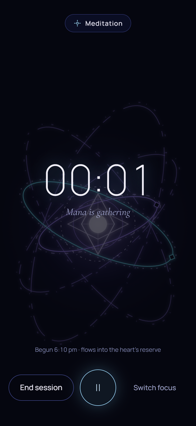
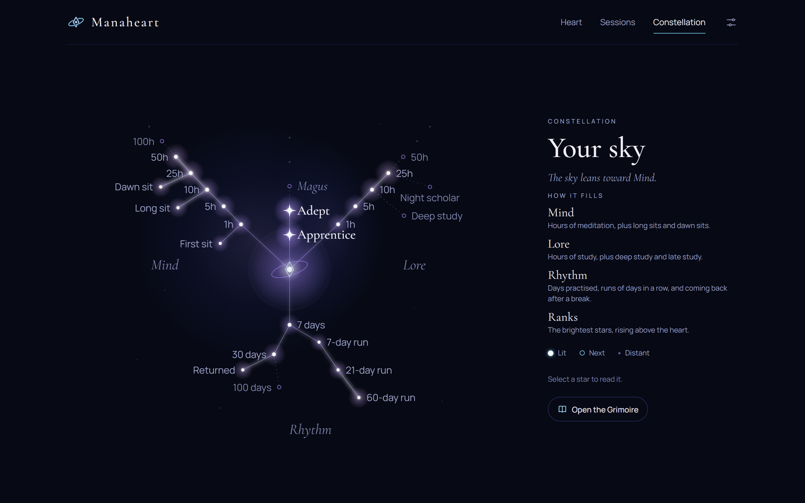

<p align="center">
  <picture>
    <source media="(prefers-color-scheme: dark)" srcset="design/manaheart-logo/png/lockups/manaheart-horizontal-dark.png">
    
  </picture>
</p>

<p align="center"><em>A quiet meditation and study tracker where the hours slowly gather into a heart of light.</em></p>

<p align="center">
  
  
</p>

## About

Manaheart borrows an idea from the webnovels and manhwas where a mage's power grows from a mana heart, ringed by circles that take years to build. Here the power comes from meditation and study instead of battles.

Logged time gathers as mana. After five hours it forms a heart, and the hours after that draw up to five circles around it. Practising most days keeps the circles steady, and once all five hold still they condense into a stronger heart and a new rank begins, from Apprentice up to Sage.

It's meant to be low on interaction: log a session, glance at the heart, and get on with the day. There are no streak flames, points or leaderboards.

## Features

- **Focus timer and manual logging**, for meditation or study, with optional notes. The timer survives reloads and sleeping phones.
- **The heart and its circles**, drawn and animated from the logs, with a beat that quickens after a session.
- **Rhythm** that rewards practising most days and forgives the odd missed one.
- **Milestones, mage paths and condensing.** After the first circle, the heart takes on an Elemental, Arcane or Spirit style.
- **The Constellation**, a night sky that fills in as practice adds up, plus a **Grimoire** with a page for each rank reached.
- **Sessions history** with editing, deleting and Undo, and an export of every session as CSV.
- **Accounts** with email and password, password reset, and account deletion.

<p align="center">
  
</p>

## Tech

- [React 19](https://react.dev) + TypeScript (strict) + [Vite](https://vite.dev)
- [Supabase](https://supabase.com) for sign-in and the database, with row-level security so each account only sees its own data
- [Vitest](https://vitest.dev) and [Testing Library](https://testing-library.com) for unit and screen tests
- CSS modules on top of a design-token system, with no UI framework

The app stores raw facts only (sessions, condense events and settings). The heart, circles, rhythm and stars are all worked out from those each time, by a pure TypeScript engine in `src/engine`, so the rules can change without migrating any data.

## Running it locally

You'll need Node 20 or newer and a Supabase project.

```bash
npm install
cp .env.example .env   # then add the Supabase project URL and anon key
npm run dev
```

The database setup (SQL migrations) and email templates aren't included in this repository.

| Command | What it does |
|---|---|
| `npm run dev` | Start the dev server |
| `npm test` | Run the test suite |
| `npm run build` | Type-check and build for production |
| `npm run lint` | Lint with oxlint |

## Project layout

```
src/
  engine/    the rules: heart, circles, rhythm, stars and the Grimoire (pure TypeScript)
  data/      Supabase access and the hooks the screens use
  heart/     the heart's drawing model and SVG
  screens/   each page of the app
  ui/        shared components from the design system
docs/        the Guide, Privacy and Terms text, which the app's pages read directly
design/      the design system, screen designs and logo
```

## Design

The visual design, design system and logo were made with Claude Design. Type is set in [Cormorant Garamond](https://fonts.google.com/specimen/Cormorant+Garamond) and [Manrope](https://fonts.google.com/specimen/Manrope), both under the SIL Open Font License.

## Contact

Questions or feedback: [manaheart.timer@gmail.com](mailto:manaheart.timer@gmail.com)
